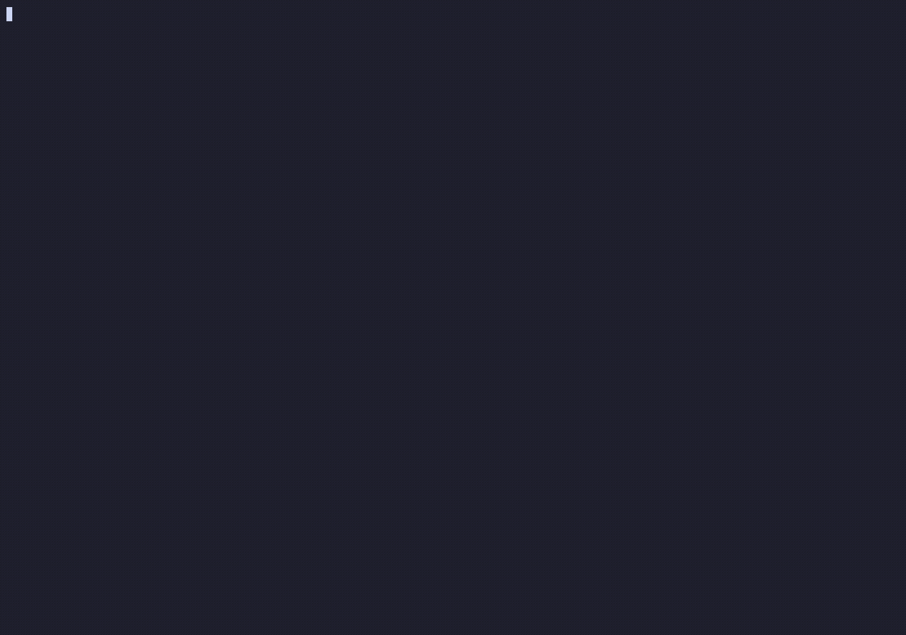

# opencode-voice

> **Speak your prompts. Hear your answers.** A voice plugin for [OpenCode](https://opencode.ai/) v2.

[](https://github.com/bojackduy/opencode-voice/actions/workflows/ci.yml)
[](LICENSE)
[](https://www.npmjs.com/package/@bojackduy/opencode-voice)



## What it does

- **Dictate** into the focused text field — **live** (words appear while you speak) or **batch** (speak, then transcribe).
- **Mac or phone mic** — local sox capture, or a phone over USB/ssh (Termux) with automatic `adb forward`.
- **Clean-up** with any OpenCode model (fixes misheard words, punctuation), or exact whisper text.
- **Fix** — press Fix and say the correction ("fix, not fit"); the LLM merges it into the current text.
- **Read replies aloud** in natural Vietnamese and English with [VieNeu-TTS](https://github.com/pnnbao97/VieNeu-TTS); Piper takes over automatically if VieNeu is unavailable. Mac speakers or the phone.
- **One status line** above the prompt shows exactly what is happening, with clickable buttons:

```
● LIVE 0:07 ▃▅▄ [⏸ Pause] [■ Done] [✕ Cancel] │ ♪ 0:05/0:12 [⏸] [■]
[● Speak] [✎ Fix] [⏎ Auto ✓] [Live] │ [▶ Reply] [↺] [Read ✓]
```

## Install

Prerequisites (macOS): `brew install sox whisper-cpp`, a ggml whisper model in
`~/.local/share/whisper-cpp/` (e.g. `ggml-large-v3-turbo-q5_0.bin`), and for
speech: Piper on `PATH` with voices in `~/.local/share/piper-voices/`, plus an
optional VieNeu-TTS Python venv. See [docs/technical.md](docs/technical.md).

Add to `~/.config/opencode/tui.jsonc` (or `cli.json` → `plugins`):

```jsonc
{
  "plugin": [
    [
      "@bojackduy/opencode-voice",
      {
        "sttMode": "streaming",
        "sttAutoSubmit": false,
        "ttsEngine": "vieneu",
        "ttsVieneuPython": "~/.local/share/opencode-voice/vieneu-venv/bin/python",
        "ttsVieneuVoice": "Mai Anh",
      },
    ],
  ],
}
```

The clean-up / Fix LLM defaults to the session's current model; pick another
with `/voice-model`, or set `endpoint` + `model` + `apiKeyEnv` explicitly.

## Keys and commands

| Key         | Command                   | What it does                                                 |
| ----------- | ------------------------- | ------------------------------------------------------------ |
| `<leader>[` | `/stt`                    | Start dictation; press again to finish (resumes when paused) |
| —           | `/stt-fix`                | Re-speak to correct the current text                         |
| —           | `/stt-pause`              | Pause / resume live dictation                                |
| `<leader>.` | `/voice-cancel`           | Cancel everything in flight                                  |
| `<leader>]` | `/tts-speak`              | Read the last reply; press again to stop                     |
| `<leader>0` | `/tts-replay`             | Replay the last reading                                      |
| —           | `/tts-pause`, `/tts-stop` | Pause / stop reading                                         |

Settings (persisted): `/stt-mode` (live/batch), `/stt-autosubmit`,
`/stt-auto-end` (finish after 2.5 s of silence), `/stt-normalize`,
`/stt-language`, `/stt-model`, `/stt-engine`, `/stt-mic`, `/tts-mode`
(auto-read replies), `/tts-engine`, `/tts-voice`, `/tts-output`,
`/voice-model`, and `/voice-status` for diagnostics.

Override keys with `"keybinds": { "stt.record": "ctrl+r", "tts.speak-last": "none" }`.

## Options

| Option                                       | Default                | Meaning                                                                                                                            |
| -------------------------------------------- | ---------------------- | ---------------------------------------------------------------------------------------------------------------------------------- |
| `sttMode`                                    | `"batch"`              | `"streaming"` (live) or `"batch"`                                                                                                  |
| `sttAutoSubmit`                              | `false`                | Send the prompt right after dictation                                                                                              |
| `sttLanguage`                                | `"auto"`               | `"auto"`, `"vi"`, `"en"`                                                                                                           |
| `sttModel`                                   | auto                   | Path to a ggml whisper model                                                                                                       |
| `sttCaptureCmd`                              | —                      | Phone mic argv, must print raw s16le mono PCM (e.g. `["ssh", "-p", "8022", "u0_a368@localhost", "$HOME/bin/capture.sh", "16000"]`) |
| `sttEndpoint`, `sttApiModel`, `sttApiKeyEnv` | —                      | Optional OpenAI-compatible transcription API                                                                                       |
| `audioSampleRate`                            | `16000`                | Capture rate                                                                                                                       |
| `ttsEngine`                                  | `"vieneu"`             | `"vieneu"` or `"piper"`                                                                                                            |
| `ttsVieneuPython`, `ttsVieneuVoice`          | venv path, `"Mai Anh"` | VieNeu sidecar                                                                                                                     |
| `ttsPlayCmd`                                 | —                      | Phone speaker argv, reads raw PCM on stdin                                                                                         |
| `endpoint`, `model`, `apiKeyEnv`             | session model          | LLM for clean-up and Fix                                                                                                           |
| `sttPrompt`, `ttsPrompt`                     | built-in               | Override the system prompts (text)                                                                                                 |

## Privacy

Audio stays on your machine unless you configure an API transcriber or a
phone. Only the transcript is sent to the LLM for clean-up (turn it off with
`/stt-normalize`). Stored OpenCode keys are only sent to their own provider.
The diagnostic log (`~/.cache/opencode-voice/voice.log`, mode 0600) never
contains transcript text.

## Changes in 2.0

Rewritten in TypeScript around two small state machines (dictation, speech)
and one status line. Conversation mode, live notes, Kokoro, Chatterbox,
Gipformer, seek and playback speed were removed. OpenCode v1 is no longer
supported. Existing settings carry over.

## License

AGPL-3.0-or-later
