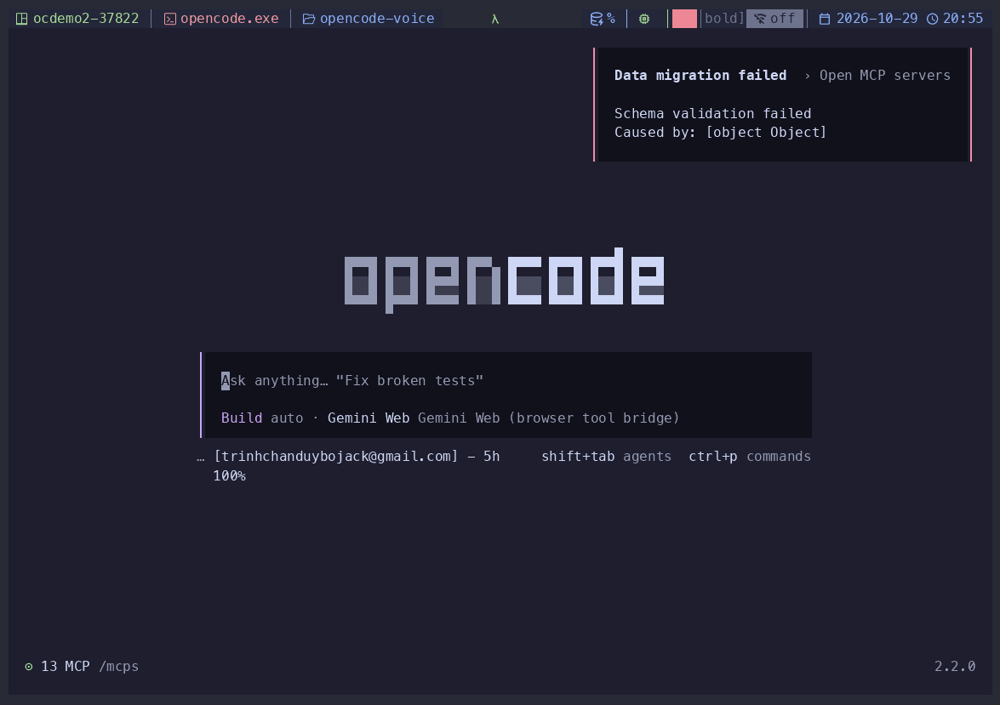

[](https://github.com/bojackduy/opencode-voice/actions/workflows/ci.yml)
[](LICENSE)
[](https://www.npmjs.com/package/@bojackduy/opencode-voice)
[](https://www.npmjs.com/package/@bojackduy/opencode-voice)

# opencode-voice

Speech-to-text and text-to-speech plugin for [OpenCode](https://opencode.ai/).

Record voice prompts with local whisper transcription, hear assistant responses
spoken aloud via Piper TTS. Both directions use an LLM to normalize text for
natural speech (fixing homophones, splitting camelCase identifiers, summarizing
code-heavy responses, etc.).



## OpenCode v1 and v2

One package runs on both OpenCode 1.x and 2.x. The plugin detects the host
by capability (never by version string) and adapts; the v1 path is unchanged.

> [!IMPORTANT]
> **Dictation inserts; it does not send.** On both v1 and v2 the transcript
> is typed at the cursor of whichever editable field currently has focus —
> the session composer, a dialog/search input, or another plugin's text
> field — leaving the text editable. Nothing is submitted unless you asked
> for it (`/stt-submit`, `sttAutoSubmit`, or conversation mode). If no
> editable field is focused, v2 keeps the transcript in a recovery dialog
> instead of sending it as a prompt.

### v1 (OpenCode 1.x)

Use the `tui.json` snippet under [Install](#install) — unchanged.

### v2 (OpenCode 2.x)

Add the plugin to `cli.json` (create at `~/.config/opencode/cli.json` if it
doesn't exist):

```json
{
  "$schema": "https://opencode.ai/v2/cli.json",
  "plugins": [
    {
      "package": "@bojackduy/opencode-voice",
      "options": {
        "endpoint": "https://api.anthropic.com/v1",
        "model": "claude-haiku-4-5",
        "apiKeyEnv": "ANTHROPIC_API_KEY"
      }
    }
  ]
}
```

Every plugin option documented below (`sttLanguage`, `ttsEngine`,
`keybinds`, …) works the same on v2 — options ride `context.options`, and
the `keybinds` command ids are stable across hosts. To test unpublished
changes, point `package` at the local repo path instead of the npm name.

To verify the plugin loaded: `opencode plugin list` shows it as a `local`
package (its TUI entrypoint is a literal `tui.js` file — v2 resolves local
packages by file probe, not by the `exports` map, so that file must exist).
Then press `Ctrl+P` or type `/` in the composer: all 19 commands are there
under the `opencode-voice` group with their slash names (`/stt-record`,
`/tts-speak`, `/voice-cancel`, …), verified live on 2.0.26.

> [!NOTE]
> **Default keybinds on v2.** The same leader shortcuts work on both hosts:
> press `Ctrl+X`, then `[` to record/stop, `]` to read the reply, `;` to stop
> playback, `v` for conversation, or `.` to cancel. The v2 keymap resolves
> `<leader>` itself, including a customized host leader. Record/stop and cancel
> dispatch were verified on v2.0.26 on both home and session screens. Plugin
> `keybinds` overrides and `"none"` still apply; palette and `/slash` remain
> available.

`engines` status: the package declares no `engines.opencode` field, so both
v1 and v2 load it unconstrained. A version pin was considered and skipped on
purpose: it could refuse to load on untested hosts for no benefit, since
capability detection already picks the right path per host.

### Per-feature v2 caveats

- **Commands:** all 19 register with the same ids, titles, palette group,
  slash names, and keybinds as v1. On 2.0.26 the `/slash` completion lists
  every one reliably; the `Ctrl+P` palette shows them for matching queries
  but its search occasionally reports no results for queries that should
  match — when in doubt, use `/slash`.
- **STT (batch):** the transcript is typed at the cursor of the focused
  editable field and nothing is sent unless submission is requested.
  On home the composer is focused, so dictation works before a session
  exists; an explicit submit creates the session, carries the selected
  model into it, and sends once. Existing sessions retain their
  agent/model. On home, v2's public plugin API exposes the selected model
  but no selected-agent getter, so session creation uses the host's
  default agent. Create/submit failures show the full transcript in a
  recovery dialog. With no editable field focused, the transcript is kept
  in that dialog instead of being sent as a prompt.
- **STT (streaming dictation):** enable with `"sttMode": "streaming"` in plugin
  options. Local whisper streaming displays a bounded live transcript above
  the prompt footer on home and session screens, with the live input waveform
  beside it. Stable words are plain;
  the tentative tail is bracketed and may change. Press the record key again
  to finalize: the full text is inserted once at the focused cursor (and
  submitted when `sttAutoSubmit` is set), or cancel to clear the preview
  without sending. Batch remains the default and produces text after
  recording stops; the hosted `sttEndpoint` option is for batch
  transcription, not this local streaming preview.
- **TTS / conversation / live notes / cancel:** same semantics as v1 (auto
  TTS on idle/permission/question gates, conversation barge-in, live-notes
  background saves, one-key cancel).
- **Reply-streaming triggers:** `message.part.delta` is remapped to v2's
  `session.text.delta`; `session.idle`, `session.status`, and
  `permission.asked` pass through unchanged. `question.asked` has no v2
  equivalent and is mapped best-effort to `form.created`: with several
  sessions open, a form in one session can pause speech in another.
  Single-session use is unaffected.
- **Pickers** (`/stt-model`, `/stt-language`, `/stt-mic`, `/tts-voice`,
  `/voice-model`): same options through promise dialogs, including the
  nested provider → model pick.
- **Settings persistence:** stored via v2 storage (survives restarts, syncs
  across windows). If storage is unavailable the plugin keeps working with
  memory-only settings for the session.
- **Logging:** v2 has no `client.app.log`, so the debug/warn/error
  diagnostics the plugin writes to the OpenCode log on v1 are silent on v2.
  User-facing warnings still arrive as toasts.

## Install

Add to your `tui.json` (create at `~/.config/opencode/tui.json` if it doesn't
exist). You must configure at least `endpoint` and `model`:

> [!NOTE]
> **Clobbering default keybinds.** This plugin uses `ctrl+r` for voice
> recording, but OpenCode assigns it to session rename by default. Session
> rename is not used frequently and is still accessible via `/rename`, so we
> clobber the factory default to let the plugin use `ctrl+r` properly. See
> the `keybinds` section in the config below.

```json
{
  "$schema": "https://opencode.ai/tui.json",
  "keybinds": {
    "session_rename": "none"
  },
  "plugin": [
    [
      "@bojackduy/opencode-voice",
      {
        "endpoint": "https://api.anthropic.com/v1",
        "model": "claude-haiku-4-5",
        "apiKeyEnv": "ANTHROPIC_API_KEY"
      }
    ]
  ]
}
```

### Refresh cached plugin after updates

If OpenCode keeps using an older published version of the plugin after an
update, clear the cached package and restart OpenCode:

```bash
rm -rf ~/.cache/opencode/packages/@bojackduy/
```

## Prerequisites

### Speech-to-text

The plugin uses [whisper.cpp](https://github.com/ggml-org/whisper.cpp) via a
`whisper-cli` binary and `sox` for microphone capture. Follow the subsection
for your OS to install the binary and verify your microphone, then run the
shared **Download model & smoke test** step at the end.

#### macOS

Install the `whisper-cpp` bottle (ships a `whisper-cli` with Metal enabled on
Apple Silicon) and `sox`:

```bash
brew install whisper-cpp sox
```

Verify your microphone by recording a 3-second clip and playing it back. The
first `sox -d` invocation triggers a macOS microphone permission prompt —
grant it in **System Settings → Privacy & Security → Microphone**, then rerun.
Remove the temp file once you've heard yourself clearly:

```bash
sox -d /tmp/mic-check.wav trim 0 3   # speak for 3 seconds
play /tmp/mic-check.wav              # you should hear yourself
rm /tmp/mic-check.wav                # delete after verification
```

#### Linux (including WSL2)

Install `sox` with its PulseAudio driver (a separate package on Debian/Ubuntu),
the PulseAudio tools so the plugin can enumerate input devices via `pactl`,
and the build tools for whisper.cpp:

```bash
sudo apt install sox libsox-fmt-pulse pulseaudio-utils build-essential cmake
```

On WSL2, make sure [WSLg](https://learn.microsoft.com/windows/wsl/tutorials/gui-apps)
is running — it bridges the Windows microphone into WSL as a PulseAudio source
(typically named `RDPSource`), which you can then pick with `/stt-mic`.

**WSL2 audio troubleshooting.** There is no `/dev/snd` in WSL2 — that is
normal. Audio goes through WSLg's PulseAudio server at `/mnt/wslg/PulseServer`,
so ALSA-only tools like `arecord -l` will never list a device. If `/stt-mic`
finds no devices or `pactl info` fails with `Connection refused`, WSLg's
PulseAudio is stuck; fix it from Windows PowerShell:

```powershell
wsl --shutdown   # then reopen Ubuntu (closes all WSL sessions)
```

If the source list is still empty after a restart, check Windows
**Settings → Privacy & security → Microphone** and enable both "Microphone
access" and "Let desktop apps access your microphone" (WSLg captures audio via
a desktop RDP client), then run `wsl --update` for the latest WSLg.

Verify your microphone by recording a 3-second clip and playing it back.
Remove the temp file once you've heard yourself clearly; skip building
whisper.cpp until this works, otherwise `/stt-mic` will have nothing to select:

```bash
sox -d /tmp/mic-check.wav trim 0 3   # speak for 3 seconds
play /tmp/mic-check.wav              # you should hear yourself
rm /tmp/mic-check.wav                # delete after verification
```

`whisper-cli` is not packaged for Linux, so build whisper.cpp from source.
Pick **one** of the two builds below.

**CPU build** — works on any machine, adequate for `tiny`/`base`/`small`
models:

```bash
git clone https://github.com/ggml-org/whisper.cpp ~/opt/whisper.cpp
cmake -B ~/opt/whisper.cpp/build -S ~/opt/whisper.cpp \
  -DCMAKE_BUILD_TYPE=Release -DWHISPER_BUILD_TESTS=OFF
cmake --build ~/opt/whisper.cpp/build -j --target whisper-cli
sudo ln -sf ~/opt/whisper.cpp/build/bin/whisper-cli /usr/local/bin/whisper-cli
```

**CUDA build** — NVIDIA GPU, ~100× faster encode for `medium`/`large` models.
Check your GPU with `nvidia-smi` and your toolkit with `nvcc --version`, then
pick the arch code from the table:

| GPU family    | Arch      | `CMAKE_CUDA_ARCHITECTURES` | Min. CUDA |
| ------------- | --------- | -------------------------- | --------- |
| RTX 20 / T4   | Turing    | `75`                       | 10.0      |
| RTX 30 / A100 | Ampere    | `86`                       | 11.0      |
| RTX 40 / L40  | Ada       | `89`                       | 11.8      |
| H100          | Hopper    | `90`                       | 12.0      |
| RTX 50 / B100 | Blackwell | `120`                      | 13.0      |

```bash
git clone https://github.com/ggml-org/whisper.cpp ~/opt/whisper.cpp
cmake -B ~/opt/whisper.cpp/build -S ~/opt/whisper.cpp \
  -DCMAKE_BUILD_TYPE=Release \
  -DGGML_CUDA=ON \
  -DCMAKE_CUDA_ARCHITECTURES=89 \
  -DWHISPER_BUILD_TESTS=OFF
cmake --build ~/opt/whisper.cpp/build -j --target whisper-cli
sudo ln -sf ~/opt/whisper.cpp/build/bin/whisper-cli /usr/local/bin/whisper-cli
```

If you have multiple CUDA toolkits installed (e.g. Blackwell requires CUDA 13
while the default `nvcc` is 12), also pass `-DCMAKE_CUDA_COMPILER=/usr/local/cuda-13.3/bin/nvcc`
to point at the matching `nvcc`. CUDA runtime libraries are resolved via
ldconfig; no `LD_LIBRARY_PATH` is needed.

At runtime the plugin records through sox's `pulseaudio` driver when `pactl`
is available, and falls back to sox's default device otherwise.

#### Download model & smoke test

Download a whisper model to `~/.local/share/whisper-cpp/` (same path on both
OSes):

```bash
mkdir -p ~/.local/share/whisper-cpp
curl -L -o ~/.local/share/whisper-cpp/ggml-large-v3-turbo-q5_0.bin \
  https://huggingface.co/ggerganov/whisper.cpp/resolve/main/ggml-large-v3-turbo-q5_0.bin
```

Smoke-test the install by transcribing a short recording:

```bash
sox -d /tmp/smoke.wav trim 0 4   # say something for 4 seconds
whisper-cli -m ~/.local/share/whisper-cpp/ggml-large-v3-turbo-q5_0.bin \
  -f /tmp/smoke.wav -l auto -nt
rm /tmp/smoke.wav
```

Check the first `system_info:` line in the output to confirm the expected
backend is active:

| Install                        | Expect                  |
| ------------------------------ | ----------------------- |
| macOS Homebrew (Apple Silicon) | `METAL = 1`             |
| Linux CUDA build               | `CUDA : ARCHS = <n>`    |
| CPU-only                       | `METAL = 0` / no `CUDA` |

Reference `encode time` on a 4-second clip: CPU `medium` ≈ 15–30 s; CUDA
`medium` ≈ 100–200 ms; CUDA `large-v3-turbo` ≈ 100–300 ms. Apple Silicon
Metal timings are hardware-dependent but typically sub-second. If your GPU
build shows CPU-level timings, the GPU backend failed to load — on Linux,
re-check `nvidia-smi` and rebuild with the arch code from the table above.

### Text-to-speech

Install [Piper](https://github.com/rhasspy/piper):

```bash
uv tool install piper-tts
```

Or with pip:

```bash
pip install piper-tts
```

The plugin looks for `piper` on your `PATH` (`~/.local/bin` is typically on `PATH`).

Download voice models to `~/.local/share/piper-voices/` (English + Vietnamese
for mixed-language replies):

```bash
mkdir -p ~/.local/share/piper-voices
curl -L -o ~/.local/share/piper-voices/en_US-ryan-high.onnx \
  https://huggingface.co/rhasspy/piper-voices/resolve/main/en/en_US/ryan/high/en_US-ryan-high.onnx
curl -L -o ~/.local/share/piper-voices/en_US-ryan-high.onnx.json \
  https://huggingface.co/rhasspy/piper-voices/resolve/main/en/en_US/ryan/high/en_US-ryan-high.onnx.json
curl -L -o ~/.local/share/piper-voices/vi_VN-vais1000-medium.onnx \
  https://huggingface.co/rhasspy/piper-voices/resolve/main/vi/vi_VN/vais1000/medium/vi_VN-vais1000-medium.onnx
curl -L -o ~/.local/share/piper-voices/vi_VN-vais1000-medium.onnx.json \
  https://huggingface.co/rhasspy/piper-voices/resolve/main/vi/vi_VN/vais1000/medium/vi_VN-vais1000-medium.onnx.json
```

### Vietnamese/English voice selection

Each call to speak (one full reply, or one sentence during conversation
streaming) picks a single voice for the whole thing - no mid-utterance
switching, since splicing separately synthesized clips sounds jarring.
The language is decided by majority vote over words: text is routed to the
Vietnamese voice only when a meaningful share of its words carry Vietnamese
diacritics, so a single stray Vietnamese word (e.g. a name) in an otherwise
English reply no longer flips the whole thing to the Vietnamese voice, and
vice versa. Toneless Vietnamese (no diacritics) still reads as English -
that is not distinguishable from English by this heuristic.

### Chatterbox engine (optional)

Piper is the default and needs no setup beyond the section above. For more
natural-sounding English, opt into [Chatterbox](https://github.com/resemble-ai/chatterbox)
(Resemble AI, MIT) as the synthesis engine. It runs as a managed sidecar
(`vendor/chatterbox_server.py`, stdlib HTTP only): the model loads once, the
plugin probes readiness, and the sidecar is killed on dispose. Playback still
goes through the existing `play` path, so `/tts-stop` and cancel behave the
same on both engines.

Setup (isolated venv, never touches your system python):

```bash
python3 -m venv ~/.local/share/opencode-voice/chatterbox-venv
~/.local/share/opencode-voice/chatterbox-venv/bin/pip install chatterbox-tts
# chatterbox's `perth` dependency needs pkg_resources (removed in setuptools ≥ 81):
~/.local/share/opencode-voice/chatterbox-venv/bin/pip install 'setuptools<81'
```

First run downloads ~7GB of weights from HuggingFace, then the sidecar takes
~20s to load on Apple Silicon (MPS). No venv, no weights, no wavs are ever
committed.

Options in `tui.json` (all under the plugin entry, next to `endpoint`):

```json
{
  "ttsEngine": "chatterbox",
  "ttsChatterboxVariant": "multilingual",
  "ttsChatterboxVoiceRef": "/absolute/path/to/voice-5-20s.wav"
}
```

- `ttsEngine`: `"piper"` (default) | `"chatterbox"`. Unknown values warn and
  use Piper.
- `ttsChatterboxVariant`: `"multilingual"` (default) | `"turbo"` | `"nano"`.
- `ttsChatterboxVoiceRef`: optional absolute path to a 5-20s reference wav
  for zero-shot voice cloning. Unset means the model default voice; a missing
  file warns and proceeds voiceless.
- `ttsChatterboxPython`: optional python binary for the sidecar. Defaults to
  `python3` on `PATH` - set it to the venv python above.

Per-utterance Piper fallback: whenever Chatterbox cannot speak an utterance,
that utterance goes to Piper with a warn log (one toast per outage, not per
utterance; the next utterance retries Chatterbox). Cases: sidecar not
installed/crashed, ~15s synthesis bound exceeded, and language routing below.

Honest limits, measured on Apple Silicon (MPS) with Multilingual V3:

- Chatterbox does **not** speak Vietnamese. Its multilingual model covers 23
  languages (`ar da de el en es fi fr he hi it ja ko ms nl no pl pt ru sv sw
th tr zh`) - `vi` is not one, so **every** Vietnamese utterance falls back
  to Piper regardless of variant. Nano/Turbo are English-only by design.
- Latency for "Deploying now.": Piper 0.77s wall for 0.80s of audio (RTF
  ~1.0); Chatterbox ~16s wall for ~1s of audio on first synthesis after load
  (RTF ~15, MPS warmup included), ~5-8s wall (RTF ~1.5-3) once warm. It is a
  quality upgrade, not a speed one.
- Outputs carry Chatterbox's inaudible PerTh watermark.

### LLM endpoint

An OpenAI-compatible LLM endpoint is required for text normalization. For
speech-to-text it cleans up whisper output (punctuation, filler words, software
engineering homophones). For text-to-speech it converts markdown into natural
spoken text.

Configure your endpoint in `tui.json` via plugin options. Any OpenAI-compatible
endpoint works (Anthropic, OpenAI, Ollama, vLLM, LM Studio, etc.). The `apiKeyEnv`
option is optional - omit it for unauthenticated endpoints like Ollama.

```json
{
  "plugin": [
    [
      "@bojackduy/opencode-voice",
      {
        "endpoint": "https://api.anthropic.com/v1",
        "model": "claude-haiku-4-5",
        "apiKeyEnv": "ANTHROPIC_API_KEY"
      }
    ]
  ]
}
```

For unauthenticated local endpoints (e.g. Ollama):

```json
{
  "plugin": [
    [
      "@bojackduy/opencode-voice",
      {
        "endpoint": "http://localhost:11434/v1",
        "model": "llama3.2"
      }
    ]
  ]
}
```

- `endpoint` _(required)_ - OpenAI-compatible base URL
- `model` _(required)_ - model name sent to `/chat/completions`
- `apiKeyEnv` _(optional)_ - environment variable containing the API key
- `maxTokens` _(optional)_ - maximum completion tokens for normalization calls
- `reasoningEffort` _(optional)_ - reasoning level for models that support it
- `chatTemplateKwargs` _(optional)_ - extra keyword arguments passed to the model's chat template (e.g. `{"enable_thinking": false}` for Qwen models to disable chain-of-thought)
- `retries` _(optional)_ - number of retry attempts for transient LLM failures
- `tmpDir` _(optional)_ - directory used for the temporary STT recording file (default `/tmp`)
- `sttLanguage` _(optional)_ - spoken language passed to local `whisper-cli -l` (default `auto`; any whisper.cpp language code, e.g. `en`, `zh`). Can be changed at runtime via `/stt-language`
- `trimSilence` _(optional)_ - whether to remove leading silence from recordings (default `true`). Set to `false` if your recordings are missing the first word or syllable

### Logging

The plugin writes diagnostics through OpenCode's structured app logger. If this plugin is not working with your setup, check the OpenCode log file and, optionally, enable debug mode. See the [OpenCode Docs](https://opencode.ai/docs/troubleshooting/#logs) for details.

Routine plugin diagnostics use `debug`; recoverable issues use `warn`; failed
child processes, API calls, or unexpected exceptions use `error`.

### STT API transcription (optional)

Instead of local `whisper-cli`, you can use an OpenAI-compatible speech-to-text
API (e.g. serving a Whisper model). This is useful when you want to run the
plugin on a machine without whisper-cpp installed.

```json
{
  "plugin": [
    [
      "@bojackduy/opencode-voice",
      {
        "sttEndpoint": "http://127.0.0.1:8000/v1",
        "sttModel": "whisper-large-v3-turbo",
        "sttApiKeyEnv": "MY_STT_API_KEY"
      }
    ]
  ]
}
```

- `sttEndpoint` _(optional)_ - OpenAI-compatible base URL with `/audio/transcriptions` support
- `sttModel` _(optional)_ - whisper model name to pass to the API (default: `whisper-large-v3-turbo`). Can be changed at runtime via `/stt-model`, which fetches available whisper models from the endpoint's `/models` listing
- `sttApiKeyEnv` _(optional)_ - environment variable containing the API key

OpenRouter note: when `sttEndpoint` points at `https://openrouter.ai/api/v1`, the plugin automatically uses OpenRouter's JSON/base64 transcription request format instead of multipart upload.

### Voice LLM selection

Instead of hand-editing `endpoint`/`model` in `tui.json`, run `/voice-model`
(palette group `opencode-voice`) to pick from OpenCode's own provider catalog
— the same providers you connected in OpenCode, no file editing:

- The selection (`voice.providerID` + `voice.modelID` in kv) fills in whatever
  `endpoint`/`model`/`apiKeyEnv` the plugin options leave out. Explicit
  options always win; `/voice-model-clear` goes back to options-only.
- Only env-key providers work (key read live from the provider's env list,
  e.g. `OPENROUTER_API_KEY`). OAuth/Console-managed credentials are invisible
  to plugins — for those, keep explicit `endpoint` options.
- The picker warns when no key is exported yet.

### Custom prompts

The LLM system prompts used for normalization can be fully replaced by pointing
to your own prompt files. This lets you fine-tune how transcriptions are cleaned
up or how responses are spoken.

```json
{
  "plugin": [
    [
      "@bojackduy/opencode-voice",
      {
        "sttPrompt": "~/.config/opencode/stt-prompt.md",
        "ttsAutoPrompt": "~/.config/opencode/tts-auto-prompt.md",
        "ttsManualPrompt": "~/.config/opencode/tts-manual-prompt.md"
      }
    ]
  ]
}
```

- `sttContextMessages` _(optional)_ - recent turns sent as knowledge with STT normalization (default `8`)
- `sttContextChars` _(optional)_ - max chars of that context (default `3000`, tail kept)
- `sttNormalizeTimeoutMs` _(optional)_ - worst-case budget per normalize call, raw transcript used on timeout (default `15000`)
- `sttNormalizeMode` _(optional)_ - `"interpretive"` (default: fix misheard words like "they face" → "database" using conversation context + workflow vocabulary) or `"strict"` (transcribe exactly, old behavior). A custom `sttPrompt` file overrides both.
- `sttAutoSubmit` _(optional)_ - one-shot `/stt-record` submits immediately instead of appending for edit (default `false`; conversation mode always submits)
- `sttMode` _(optional)_ - `"batch"` (default: record-then-transcribe as today) or `"streaming"` (live local dictation, see below)
- `sttStreamWindowMs` _(optional)_ - rolling audio window per live transcription (default `10000`)
- `sttStreamStepMs` _(optional)_ - live transcription cadence in ms (default `1000`)
- `sttPrompt` _(optional)_ - system prompt for cleaning up whisper transcriptions
- `ttsAutoPrompt` _(optional)_ - system prompt for auto-speaking assistant responses
- `ttsManualPrompt` _(optional)_ - system prompt for manually reading responses aloud

If a path is not set, the built-in default prompt is used.

## Commands

### Speech-to-text

| Command         | Keybind    | Description                                                                |
| --------------- | ---------- | -------------------------------------------------------------------------- |
| `/stt-record`   | `ctrl+r`   | Start/stop recording + transcribe                                          |
| `/stt-submit`   | `leader+r` | Stop recording, transcribe, and submit                                     |
| `/stt-stop`     |            | Cancel recording                                                           |
| `/stt-pause`    |            | Pause/resume live dictation (streaming only; mic frozen, nothing recorded) |
| `/stt-model`    |            | Select whisper model                                                       |
| `/stt-language` |            | Select transcription language                                              |
| `/stt-mic`      |            | Select microphone                                                          |

`/stt-mic` lists CoreAudio input devices on macOS, and PulseAudio sources on
Linux (via `pactl`, monitor sources excluded). On systems without a supported
device listing, "System default" uses sox's default device (`sox -d`).

`/stt-language` offers a curated list of common languages (plus auto-detect)
and only affects local `whisper-cli` transcription, not the STT API. Languages
outside the list can be set via the `sttLanguage` plugin option.

In `streaming` mode (`sttMode: "streaming"`), `/stt-record` toggles
start/finalize of a live dictation session instead of one-shot recording
(see "Streaming dictation" below); `/stt-submit` finalizes and submits via
the dictated field only; `/stt-stop` cancels and removes only dictated text.
`/stt-pause` (or the ⏸ button in the live preview) freezes the mic
mid-dictation so noise never enters the transcript; pressing record while
paused resumes instead of finalizing.

### Text-to-speech

The `leader` key in OpenCode is `ctrl+x`. So `leader+s` means press `ctrl+x`
then `s`.

| Command      | Keybind    | Description              |
| ------------ | ---------- | ------------------------ |
| `/tts-speak` | `leader+s` | Read last response aloud |
| `/tts-mode`  |            | Toggle auto TTS on/off   |
| `/tts-stop`  |            | Stop playback (palette; global `leader+.` also stops) |
| `/tts-voice` |            | Select TTS voice         |
| `/tts-engine`|            | Select TTS engine (piper / chatterbox / vieneu) |
| `/tts-pause` |            | Pause/resume TTS playback (mid-speech, no restart) |
| `/tts-replay`| `leader+0` | Replay from start        |
| `/tts-rewind`| `leader+-` | Rewind 5 seconds         |
| `/tts-forward`| `leader+=`| Forward 5 seconds        |
| `/tts-rate`  |            | Cycle/select playback speed 0.75x-2x (persisted) |

### Voice conversation

| Command                    | Keybind    | Description                                 |
| -------------------------- | ---------- | ------------------------------------------- |
| `/voice-conversation`      | `leader+v` | Toggle push-to-talk voice conversation mode |
| `/voice-conversation-stop` |            | Exit voice conversation mode                |

One key drives the whole loop. It always means the same thing - "I want the
floor" - and what it does follows the toast on screen:

```
press -> record -> press -> transcribe -> normalize -> submit -> speak -> auto-listen ...
```

| Toast shows              | Pressing the key does                     |
| ------------------------ | ----------------------------------------- |
| Press `leader+v` to talk | Open the mic (this is the resting state)  |
| ● Recording              | Finish the turn and submit                |
| Working... / Speaking    | Barge in: cut audio, drop reply, open mic |
| Answer on screen         | Same barge-in, while the agent resumes    |
| Transcribing...          | Report busy - too short to interrupt      |

The loop never reopens the mic by itself: after a reply is spoken the mode rests
paused, so it cannot record the room while nobody is talking. Barge-in drops
the pending reply on purpose - pressing means talking now, not hearing the
rest.

**Hands-free mode:** In streaming mode, recording auto-finalizes after 1.5s of
silence (no keypress needed). After the reply is spoken, the mic re-opens
automatically after a short delay. Press the key to barge in at any time.

Answering a permission or a question is the one thing the key cannot do,
because that answer is given on screen. The mode announces the gate, keeps the
mic shut, then speaks the agent's answer once the agent resumes.

Exit paths: a stop phrase (`stop`, `stop stop`, `dừng lại đi`, ...),
`/voice-conversation-stop`, or the global `/voice-cancel` (`leader+.`). Only a
bare stop phrase ends the mode - full sentences mentioning stop submit
normally. Empty or failed turns pause instead of re-recording, so the key never
surprises. `/tts-stop` pauses a speaking reply and rests paused. While the mode
is on, the plain `/stt-record` keys act as the conversation key and auto TTS
stays silent (the loop speaks the reply itself).

While waiting, assistant text is spoken sentence by sentence as it streams in
(local cleanup, no LLM), so the answer starts before the agent turn finishes.
Code-like sentences are skipped; replies with nothing streamable fall back to
the full narrated speak.

- `ttsNormalizeMode` _(optional)_ - `"llm"` (default, polished narration) or
  `"local"` (instant deterministic cleanup, no network). Streaming speech
  always uses the local path.

Options: `conversationMaxTurns` (default `50`), `conversationTimeoutMs`
(default `300000`), `conversationRestartDelayMs` (default `350`),
`conversationStopPhrases` (custom stop-phrase list). Keybind override:
`"keybinds": { "voice.conversation": "none" }`.

### Live voice notes

Continuous meeting/lecture transcription: the mic stays on and keeps
recording while a background lane transcribes and cleans up what was already
said, so a 30-minute meeting never blocks on waiting for whisper or the LLM.

| Command               | Description                                               |
| --------------------- | --------------------------------------------------------- |
| `/voice-notes-start`  | Start continuous recording with background transcription  |
| `/voice-notes-stop`   | Stop, flush the last bit of audio, and wait for the save  |
| `/voice-notes-cancel` | Stop capturing immediately; finishes saving in background |
| `/voice-notes-status` | Show elapsed time, chunks written/queued, and write lag   |

No default keybind (palette/slash only, to avoid clashing with one-shot STT
or conversation mode - only one of the three can be active at a time).

Output goes to `voice-notes/<date>-<time>-notes.md` in your workspace (a
custom title becomes the file name via `notesTitle`, and `notesDir` moves the
folder). Two files are written per session:

- `<name>.md` - the readable, cleaned transcript with `[HH:MM:SS]` timestamps
- `<name>.raw.jsonl` - one JSON line per chunk with the raw whisper text,
  normalized text, and timings, for recovery if a normalization pass
  hallucinated

Recording is split into chunks on natural pauses (silence-aware), with a
forced cut every 20 seconds during continuous speech so processing never
falls more than ~20s behind. A forced cut carries a short audio overlap into
the next chunk so a word is never fully lost mid-cut; the writer removes the
duplicated words from the merged transcript automatically.

For local whisper transcription, live notes starts a persistent
`whisper-server` process (loads the model once) instead of the one-shot
`whisper-cli` path (which reloads the model - and would fall behind - on
every chunk). If `whisper-server` isn't installed or fails to start, it
falls back to per-chunk `whisper-cli` automatically. The `sttEndpoint` API
option, model, and language are reused from one-shot STT settings.

Multi-TUI: each OpenCode window runs its own server — the first takes
127.0.0.1:8090, the next window takes the next free port up (8091, ...).
No configuration needed; each server loads its own model copy, so allow
roughly 2 GB RAM per window.

Far-field voices (a professor meters from the mic) are enhanced before
whisper hears them: each chunk is measured and gained up to a healthy speech
level with `sox` (`highpass 80` for room rumble + adaptive `gain -l` with the
limiter on, so quiet speech gets louder and loud speech is untouched). The
per-chunk levels land in the JSONL sidecar (`audio.rmsBefore/rmsAfter/gainDb`)
so you can see what the room actually sounded like. Silence detection also
learns the room: the first ~1.5s of mic audio sets the speech/silence
threshold instead of assuming one value fits every room.

Whisper hallucinates YouTube outros on quiet audio ("Hãy subscribe cho kênh
...", "thank you for watching") - those are filtered by phrase (English +
Vietnamese), and any transcript that repeats verbatim 3x in a row is treated
as a repeat hallucination. Filtered chunks stay in the JSONL sidecar but never
reach the readable transcript.

Classroom tip: the LLM cleanup pass is slow over a network gateway and adds
lag per chunk - for lectures set `notesNormalize: false` (raw whisper text,
still enhanced + filtered) and clean up afterwards.

Options:

- `notesDir` _(optional, default `"voice-notes"`)_ - output folder, relative
  to the workspace unless absolute
- `notesTitle` _(optional)_ - included in the session file name
- `notesChunkMaxSeconds` _(optional, default `20`)_ - forced cut duration
- `notesMinChunkSeconds` _(optional, default `3`)_ - minimum audio before a
  natural (silence-triggered) cut is allowed
- `notesSilenceMs` _(optional, default `700`)_ - pause length that closes a
  chunk naturally
- `notesOverlapMs` _(optional, default `400`)_ - audio overlap carried across
  a forced cut
- `notesNormalize` _(optional, default `true`)_ - set `false` to skip the LLM
  cleanup pass and write raw whisper text only
- `notesKeepAudio` _(optional, default `false`)_ - keep each transcribed
  chunk's WAV file under `<name>-audio/` instead of deleting it
- `notesUseWhisperServer` _(optional, default `true`)_ - set `false` to force
  per-chunk `whisper-cli` even when `whisper-server` is available
- `notesEnhance` _(optional, default `true`)_ - voice-only preprocessing
  (adaptive gain + rumble filter) before whisper; set `false` if the mic is
  already close/loud
- `notesEnhanceTargetRms` _(optional, default `0.1`)_ - speech level chunks
  are gained up to
- `notesEnhanceMaxGainDb` _(optional, default `24`)_ - gain ceiling so
  near-silence never becomes amplified noise
- `notesSilenceRms` _(optional)_ - explicit speech/silence RMS threshold,
  disables room auto-calibration when set
- `notesCalibrationMs` _(optional, default `1500`)_ - mic audio used to learn
  the room noise floor at session start; set `0` to disable

Not in v1: speaker diarization, automatic summaries/action items, and
uploading the notes anywhere - the Markdown file stays local.

### Global cancel

| Command         | Keybind    | Description                        |
| --------------- | ---------- | ---------------------------------- |
| `/voice-cancel` | `leader+.` | Stop any in-flight voice operation |

One keypress cancels whatever is running: batch recording (or its
transcribe/normalize pipeline), streaming dictation, TTS playback (or a
pending speech handoff), the voice-conversation loop, and live-notes capture
(live notes finishes saving in the background, like `/voice-notes-cancel`).
Idle invocations toast `Nothing to cancel`. Keybind override:
`"keybinds": { "voice.cancel": "none" }`.

### Streaming dictation

Live local dictation for short prompts: the mic stays on, partial
transcriptions stream in as you speak, and one press of `/stt-record`
finalizes the text at the focused cursor on both hosts.
Set `"sttMode": "streaming"` in the
plugin options (default `"batch"` keeps the record-then-transcribe flow
exactly as before).

How it works: a rolling audio window (default 10 s, every 1 s) is
transcribed by a persistent local `whisper-server` (model loaded once, no
per-utterance reload) and folded into stable + tentative text. No LLM is
involved anywhere in the streaming path — raw whisper text only — so it
costs zero quota and works fully offline once the model is downloaded.

What you see: a sticky status toast stays up for the whole session so
there is never a silent gap — `Loading speech model…` during cold start,
`● Streaming dictation — listening` with an elapsed timer while live
(plus a `(listening…)` note when inference runs slow), and `Finalizing…`
between the second keypress and finalization. On v2, a bounded transcript
above the prompt footer updates during recording, with the live input
waveform beside it: stable words are plain, tentative words are bracketed.
Finalization inserts the full text once at the focused cursor; cancel clears
the preview without sending.
The OpenCode renderer only
exposes `insertText`/`submit`, with no live range-replacement API, so
partials render as preview toasts (`🎙 ...`) alongside (not instead of)
the sticky status, and the full text is inserted EXACTLY ONCE at
finalize. If no editable field is focused, the transcript is kept visibly
(v2 recovery dialog, v1 toast) instead of being redirected into the chat.
`/stt-submit` submits only through the dictated field's own `submit()` — a
field that cannot submit keeps its text un-submitted rather than falling
through to the primary chat. `/stt-stop` cancels and removes only
plugin-dictated text, never your typed prefix/suffix.

Warm server: the whisper model stays loaded across dictations (finalize
and cancel keep the lease); it reloads only on model/language change,
plugin unload, or a proven server fault. If the server fails mid-stream,
the error names the cause and the recorded audio is kept for a later
batch run. Streaming refuses while batch recording, live notes, or voice
conversation is active (and vice versa). Like live notes, streaming takes
the next free port when 8090 is owned by another window (see above).

Classroom/batch guidance: streaming is tuned for short dictations (prompt
length, seconds to a few minutes). For lectures and meetings, use live
voice notes instead — its chunked pipeline, overlap handling, and raw
JSONL sidecar are built for 30-minute sessions, while streaming keeps at
most ~5 minutes of bounded spool audio per session.

Options:

- `sttMode` _(optional, default `"batch"`)_ - `"streaming"` selects this mode
- `sttStreamWindowMs` _(optional, default `10000`)_ - rolling audio window
- `sttStreamStepMs` _(optional, default `1000`)_ - live transcription cadence
- `sttAutoSubmit` applies after streaming finalize on both hosts (submit via
  the dictated field only, as above).

Measured latencies (Apple M3 Pro, 36 GB, whisper.cpp 1.9.4 with Metal,
`ggml-large-v3-turbo-q5_0.bin`, scripted speech through the real
`/inference` path — goals from the plan, measured here, not promises):

| Measure                                                                  | Measured                          |
| ------------------------------------------------------------------------ | --------------------------------- |
| Cold model-load to server ready                                          | ~1.0–1.5 s                        |
| First inference, cold server, 10 s window                                | ~0.9 s (≈1.9 s total after spawn) |
| Warm 10 s-window transcribe (plain)                                      | ~0.9 s                            |
| Warm 10 s-window transcribe (verbose format, with segments; opt-in only) | ~1.7 s                            |
| Stop-to-final, 2 s tail                                                  | ~0.8 s                            |

Honest limitations: ticks default to the plain format (~0.9 s per 10 s
window on the hardware above, no segments fetched — the stability
tracker is text-anchored and never reads segments), so partials refresh
at roughly that rate, not every cadence tick — the scheduler coalesces
while inference is busy, so partials are flicker-free but not instant.
Only one smaller-model data point exists (none: no smaller model file is
installed locally, and nothing was downloaded for measurement). E2E
coverage is mic-less: v1 session flows are proven
through the real command paths with faked capture/renderer
(`test/streaming-e2e.test.js`, `test/streaming-gaps.test.js`), while the
numbers above come from the real server path with scripted audio — no
live-mic session was measured. v2 preview rendering was additionally verified
in the real v2.0.26 TUI using injected stable/tentative text on home and
session screens; final-once/cancellation flows use scripted capture and the
real streaming controller in `test/v2-preview.test.js`.

## How it works

### STT pipeline

1. `sox` records audio from your microphone (CoreAudio on macOS, PulseAudio on
   Linux when `pactl` is available, sox default device otherwise)
2. `whisper-cli` transcribes locally using a ggml model, or an OpenAI-compatible
   API endpoint if `sttEndpoint` is configured
3. LLM normalizes the transcription: fixes punctuation, removes filler words,
   corrects software engineering homophones ("Jason" to "JSON", "bullion" to
   "boolean", etc.)
4. Cleaned text is inserted at the cursor of the focused editable field
   (composer, search, or plugin input), or submitted immediately when
   `/stt-submit` (or `sttAutoSubmit`) is used. If normalization fails (e.g.
   LLM endpoint unreachable), the raw transcription is used as a fallback
   so you never lose your input

### TTS pipeline

1. When the assistant finishes responding (or on manual trigger), the response
   text is sent to the LLM for speech normalization
2. The LLM decides how to handle it: narrate simple answers, summarize
   code-heavy responses, or briefly notify for confirmations
3. Piper synthesizes speech locally, piped through sox for playback

The LLM is only a polish layer: when the configured model is unavailable or out
of quota, TTS speaks the local cleanup automatically instead of going silent.
Set `ttsNormalizeMode: "local"` to skip narration entirely.

### Auto TTS

When enabled (`/tts-mode`), the plugin automatically speaks:

- Assistant responses when a session goes idle after work
- Permission requests
- Questions that need your answer

## Demo

The GIF above was recorded with `asciinema` + `agg` driving the OpenCode TUI
via `tmux`. To regenerate it after changing commands or UI:

```bash
scripts/record-demo.sh assets/demo.cast /path/to/project
agg assets/demo.cast assets/demo.gif
```

Requires `tmux`, `asciinema`, and `agg` on PATH.

For a **full voice demo** (waveform + conversation UI, needs a working mic and
whisper model), run the provided expect script locally:

```bash
scripts/record-voice.sh assets/voice.cast /path/to/project
# or drive manually:
expect scripts/demo-voice.exp   # inside an asciinema session
```

## Contributing

opencode-voice is open to contributions and ideas!

### Issue conventions

**Format:** `type: brief description`

- `feat:` new features or functionality
- `fix:` bug fixes
- `enhance:` improvements to existing features
- `chore:` maintenance tasks, dependencies, cleanup
- `docs:` documentation updates
- `build:` build system, CI/CD changes

### Development

```bash
npm run check        # lint + fmt
npm run lint         # oxlint
npm run fmt          # oxfmt --check
npm run fmt:fix      # oxfmt --write
```

### Test local plugin in OpenCode

To test unpublished changes in the OpenCode TUI, point `~/.config/opencode/tui.json`
at the local repo path, not the npm package name:

```json
{
  "$schema": "https://opencode.ai/tui.json",
  "plugin": ["/Users/your-user/opencode-voice"]
}
```

### Optional macOS Hammerspoon integration

If you use macOS, [Hammerspoon](https://www.hammerspoon.org/), and
[Ghostty](https://ghostty.org/), see
[`examples/hammerspoon/ghostty-fn.lua`](examples/hammerspoon/ghostty-fn.lua)
for an optional global `Fn` key setup.

Behavior:

- Press `Fn` to send `ctrl+r` and start recording.
- Hold `Fn` for at least 0.5 seconds and release to send `leader+r`, which
  stops recording, normalizes, and submits the prompt.

Notes:

- It assumes OpenCode is using the default leader key, `ctrl+x`.
- It assumes OpenCode is running in Ghostty terminal `1`.
- It is best used as a push-to-talk flow: hold `Fn` while speaking, then
  release to submit.
- Adjust `APP_NAME`, `TARGET_TERMINAL`, and `LONG_PRESS_THRESHOLD_SECONDS` to
  fit your setup.

### Release process

Manual releases via opencode; see [RELEASE_PROCESS.md](RELEASE_PROCESS.md).

## License

This project is licensed under the [MIT License](LICENSE).
